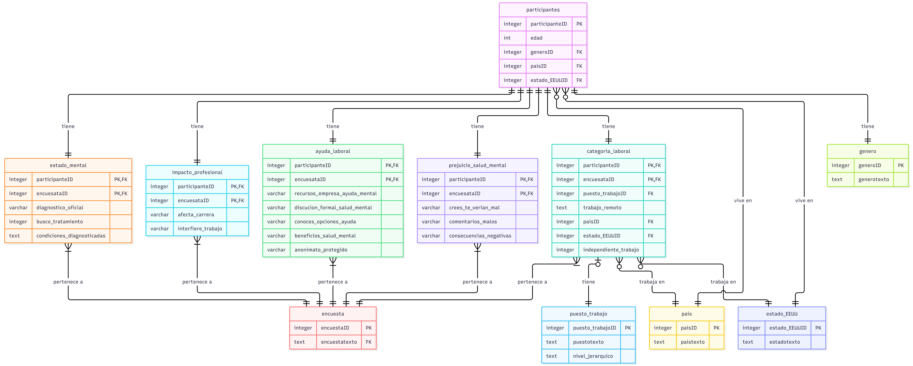

# Puesto de Trabajo y su Relación con la Salud Mental en el Ámbito Tecnológico


## Descripción del Proyecto

Este proyecto analiza cómo difieren las percepciones de perjuicio profesional por motivos de salud mental según el nivel jerárquico del puesto de trabajo y el grupo de edad en trabajadores del sector tecnológico, utilizando datos de la encuesta OSMI Mental Health in Tech Survey. El estudio emplea un ANOVA factorial de dos vías con interacción como técnica inferencial principal, complementado con análisis descriptivo y visualización de datos para explorar las diferencias entre los grupos e identificar los segmentos más vulnerables.

---

## 🔬 Metodología Estadística

Investigación de nivel descriptivo-correlacional, con diseño no experimental, transversal y documental sobre fuente secundaria. Al trabajar con una muestra no probabilística y de participación voluntaria, los resultados no permiten generalizaciones estrictas a toda la población del sector tecnológico global. En consecuencia, la inferencia estadística se aborda mediante un ANOVA factorial de dos vías con interacción como única técnica inferencial. Los hallazgos se complementan con análisis descriptivo y visualización de datos para explorar las diferencias entre los grupos, y se interpretan dentro de las limitaciones del sesgo de autoselección.

### Pregunta de la Investigación

> ¿Difiere la percepción de perjuicio profesional por motivos de salud mental según el nivel jerárquico y el grupo de edad en el sector tecnológico?

### Objetivos específicos

1. Caracterizar socio-demográficamente a la muestra de trabajadores del sector tecnológico (edad, género, nivel jerárquico y país).
2. Describir la distribución de la percepción de perjuicio profesional por nivel jerárquico y grupo de edad.
3. Analizar la relación entre la edad y la percepción de perjuicio dentro de cada nivel jerárquico.
4. Determinar si existen diferencias significativas en la percepción de perjuicio según el nivel jerárquico y el grupo de edad, y si existe interacción entre ambos factores.

## 🛠️ Arquitectura del Proyecto

En proceso

### ¿Por qué este conjunto de herramientas?

En proceso

### Base de datos

### 📌 [**Mental Health in the Tech Industry**](https://www.kaggle.com/datasets/anth7310/mental-health-in-the-tech-industry)

### Fase de normalización

El sistema original utilizaba un esquema EAV (Entidad-Atributo-Valor) que, aunque flexible para recolectar datos dispersos, presentaba problemas de rendimiento y carecía de integridad de tipos, por lo que se rediseñó la información hacia un modelo relacional normalizado en Tercera Forma Normal (3FN). Para lograrlo, se filtraron únicamente las variables clave de la investigación y se establecieron dos entidades principales independientes (Participantes y Encuestas) que eliminan las dependencias parciales de la 2FN y sirven de anclaje para todo el sistema.

A partir de estas bases, la información útil se organizó en entidades categóricas dependientes que agrupan los datos por dominios temáticos —como situación laboral, estado mental, impacto profesional, apoyo corporativo y prejuicios— vinculados de forma uno a uno con los participantes y uno a muchos con las encuestas. Asimismo, se separaron las dependencias transitivas en catálogos independientes de referencia para los puestos, géneros, países y estados, logrando una estructura consistente, sin duplicidades y altamente optimizada para consultas analíticas.



---

## Guía de instalación y uso:

En proceso

---

## 📁 Estructura del Repositorio

```
├── app.py                    # Código principal de la App de Streamlit
├── requirements.txt          # Librerias de Python
├── README.md.                # Documentación del repositorio
├── .streamlit
│   └──config.toml            # Tema visual de la app
│ 
├── pages/
│   ├── 01_Inicio.py                # Página de inicio
│   ├── 02_Marco_Metodologico.py    # Operacionalización y metodología
│   ├── 03_Marco_Teorico.py         # Fundamentos conceptuales
│   ├── 05_Conclusiones.py          # Hallazgos y recomendaciones
│   └── 06_Bibliografia.py          # Referencias bibliográficas
│
```
--- 
## 🔍 Equipo de investigación
- **Nicole Altera**
- **Danmara Dos Ramos**
- **Arianna Oliveros**
- **Camila Santiago**
- **Sebastian Soto**


